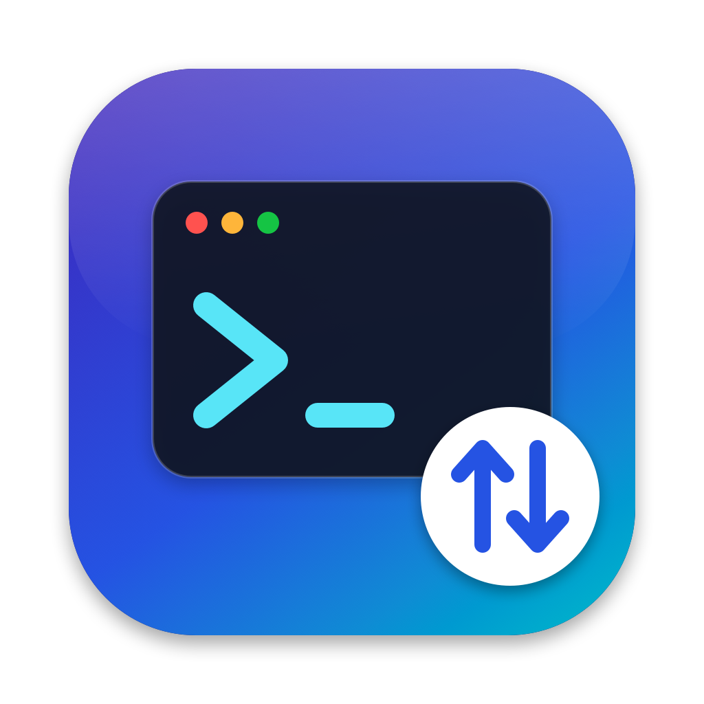

<p align="center"></p>

<h1 align="center">RemoteSSH</h1>

<p align="center">A fast, modern <b>SFTP, FTP and FTPS</b> file transfer client for <b>macOS, Windows and Linux</b>.<br><a href="https://fahed-alhammadi.github.io/RemoteSSH/">fahed-alhammadi.github.io/RemoteSSH</a></p>

<p align="center">
  <a href="https://github.com/Fahed-Alhammadi/RemoteSSH/releases/latest"></a>
</p>

RemoteSSH has two code bases that share one feature set and one site file format:

| Platform | App | Folder |
| --- | --- | --- |
| macOS 15+ | Native SwiftUI app | [`macos/`](macos) |
| Windows 10+ (x64, arm64) | Electron + React app from [`electron/`](electron), packaged by [`windows/`](windows) | [`windows/`](windows) |
| Linux (x64, arm64) | Electron + React app from [`electron/`](electron), packaged by [`linux/`](linux) | [`linux/`](linux) |

## Features

- **Connect:** a Quickconnect bar (`sftp://user@host:port/path`) and a Site Manager with folders, logon types (anonymous, normal, ask for password, key file) and default folders.
- **Secure storage:** saved passwords go into the system keychain (macOS Keychain, Windows DPAPI, or the Secret Service/KWallet on Linux). If no keyring is available, RemoteSSH asks for the password instead of saving it in plain text.
- **SFTP:** password or key-file login with Ed25519 and RSA keys (rsa-sha2-256/512), including passphrase-protected keys. Host keys are checked against SHA-256 fingerprints, and you are warned if a key changes.
- **FTP/FTPS:** explicit or implicit TLS. Before any password is sent, you are asked about certificates that can't be verified.
- **Browsing:** local and remote panes side by side, with sortable columns, a filter, file-type icons, hidden files, directory comparison, synchronized browsing, and drag & drop between panes and from your file manager.
- **File operations:** create, rename, delete (recursively), change permissions, and View/Edit (open a remote file locally and upload it again when you save).
- **Transfer queue:** parallel transfers, queued/failed/done tabs, automatic retries, resume, a choice of what to do when a file already exists, and speed limits. The queue is kept across restarts.
- **Automatic updates:** checks GitHub for a new release at startup (or *Check for Updates…* in the menu), then downloads, installs and relaunches. The Windows portable `.exe` and Linux `.tar.gz` builds only open the download page.
- **Import/export:** `File → Export Sites…` writes a `.remotessh` file and `File → Import from RemoteSSH…` reads one. The same file works on every platform. Passwords are only included if you choose to.

## Download

Every [release](../../releases/latest) has the packages for all platforms:

- **Windows:** `RemoteSSH-x.y.z-win-x64.exe` (installer), `-win-arm64.exe`, or `RemoteSSH-x.y.z-portable.exe`.
- **Linux:** `.AppImage`, `.deb` (Debian/Ubuntu) or `.tar.gz`, for x64 and arm64.
- **macOS:** `RemoteSSH-x.y.z-macos.zip`.

The macOS app is signed with a Developer ID and notarized by Apple, so it opens without a warning. The Windows builds are not code-signed: SmartScreen shows a warning the first time, so click *More info → Run anyway*.

## Build from source

### Windows and Linux (`electron/`)

You need Node.js 22 or later. The shared Electron app lives in `electron/`; `windows/` and `linux/` hold each platform's packaging settings (`electron-builder.json`) and receive its packages in `dist/`.

```bash
cd electron
npm ci
npm start              # build and run
npm test               # unit tests
npm run test:live      # + live FTP/FTPS/SFTP tests (Linux/macOS: needs sshd, python3, openssl)
npm run dist:linux     # → ../linux/dist/*.AppImage, *.deb, *.tar.gz
npm run dist:win       # → ../windows/dist/*.exe (works from Windows, macOS or Linux)
```

### macOS (`macos/`)

You need macOS 15 or later with Xcode or the Xcode Command Line Tools.

```bash
cd macos
./scripts/build-app.sh          # → dist/RemoteSSH.app (ad-hoc signed)
./scripts/integration-test.sh   # unit tests + live FTP/FTPES/SFTP tests against throwaway local servers
```

## Where data is stored

| | Sites, known hosts, queue, settings | Passwords |
| --- | --- | --- |
| macOS | `~/Library/Application Support/RemoteSSH/` | Keychain (service `RemoteSSH`) |
| Windows | `%APPDATA%\RemoteSSH\` | `secrets.json`, encrypted with DPAPI |
| Linux | `~/.config/RemoteSSH/` | `secrets.json`, encrypted using the Secret Service or KWallet |

## License

[MIT](LICENSE) © Fahed Alhammadi
