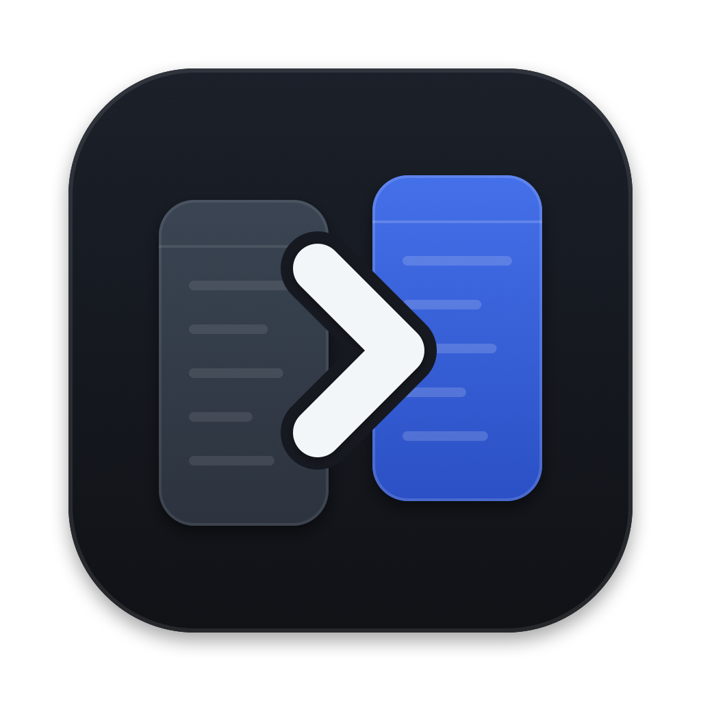
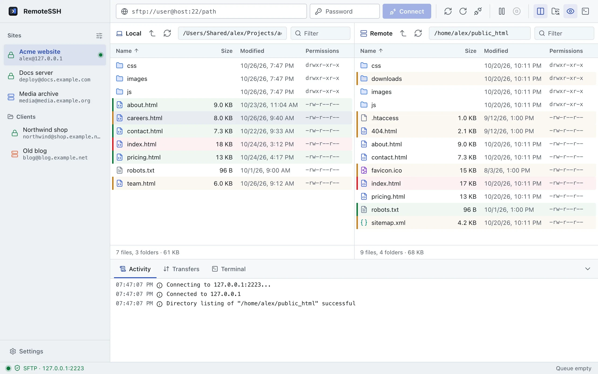

<p align="center"></p>

<h1 align="center">RemoteSSH</h1>

<p align="center">A free SFTP, FTP and FTPS client for macOS, Windows and Linux.<br>Your computer and your server side by side, with a transfer queue and an SSH terminal.</p>

<p align="center">
  <a href="https://github.com/Fahed-Alhammadi/RemoteSSH/releases/latest"></a>
  <a href="https://github.com/Fahed-Alhammadi/RemoteSSH/actions/workflows/macos.yml"></a>
  <a href="https://github.com/Fahed-Alhammadi/RemoteSSH/actions/workflows/windows.yml"></a>
  <a href="https://github.com/Fahed-Alhammadi/RemoteSSH/actions/workflows/linux.yml"></a>
  <a href="LICENSE"></a>
</p>

<p align="center">
  <a href="https://fahed-alhammadi.github.io/RemoteSSH/">Website</a> ·
  <a href="#download">Download</a> ·
  <a href="#features">Features</a> ·
  <a href="https://github.com/Fahed-Alhammadi/RemoteSSH/issues">Report a problem</a>
</p>

<p align="center">
  <picture>
    <source media="(prefers-color-scheme: dark)" srcset="docs/images/app-dark.webp">
    
  </picture>
</p>

## Why RemoteSSH

- **Both sides at once.** Your local folder and the server's folder side by side, with newer, missing and different files marked.
- **The protocols hosts use.** SFTP with a password or an Ed25519/RSA key, and FTP with explicit or implicit TLS.
- **Asks before it trusts.** Host keys and certificates are checked before your password is sent. Saved passwords go into the system keychain.
- **A terminal when you need one.** Open a shell on the server, in the folder you're looking at, without leaving the app.
- **The same everywhere.** One layout, one feature set and one site file on macOS, Windows and Linux. Native SwiftUI on the Mac.
- **Free and private.** No account, no analytics, MIT licensed.

## Download

Every [release](https://github.com/Fahed-Alhammadi/RemoteSSH/releases/latest) includes packages for all platforms. The [website](https://fahed-alhammadi.github.io/RemoteSSH/#download) picks the right file for your system.

| System | Requirements | File |
| --- | --- | --- |
| macOS | macOS 15 or later, Apple silicon | `RemoteSSH-x.y.z-macos.zip`: unzip and drag into Applications |
| Windows | Windows 10 or 11 | `RemoteSSH-x.y.z-win-x64.exe` or `-win-arm64.exe` (installer), or `RemoteSSH-x.y.z-portable.exe` (x64) |
| Linux | x64 or Arm64 | `.AppImage`, `.deb` for Debian and Ubuntu, or `.tar.gz` |

The macOS app is signed with a Developer ID and notarized by Apple, so it opens without a warning. The Windows builds are not code-signed, so Windows lists the publisher as *Unknown publisher* and SmartScreen may show *Windows protected your PC* the first time. Choose *More info → Run anyway*. Every release file is built from this repository by GitHub Actions, and the release page lists each file's SHA-256 checksum if you want to compare it with your download.

**Updates:** the apps look for a new release at startup (you can turn this off in Settings) or when you choose *Check for Updates…*, and install it when you agree. The Windows portable `.exe` and the Linux `.tar.gz` open the release page instead.

## Features

| Area | What you get |
| --- | --- |
| **Connect** | Type an address such as `sftp://user@host:port/path` and press Connect, or save servers in the Site Manager with folders, logon types (normal, anonymous, ask for password, key file) and default folders. Saved sites are listed in a sidebar; one click connects. |
| **Browse** | Sortable columns, a filter, file-type icons, hidden files, directory comparison, synchronized browsing, and drag and drop between the panes and from your file manager. |
| **Files** | Create, rename, delete (recursively) and change permissions. View/Edit opens a remote file in your editor and uploads it again when you save. |
| **Transfer queue** | Parallel transfers, queued/failed/done tabs, automatic retries for dropped connections, resume, a choice of what to do when a file already exists, and speed limits. Unfinished transfers are kept across restarts, ready to retry. |
| **SSH terminal** | For SFTP sites, the Terminal tab opens a shell on its own connection, in the folder you're viewing. Toggle it with Ctrl+`, or use *Open Terminal Here* on a remote folder. On Windows and Linux, copy and paste with Ctrl+Shift+C / Ctrl+Shift+V. |
| **Workspace** | The activity log, transfer queue and terminal share one resizable panel below the panes. It can be collapsed, and the terminal maximized. |
| **Appearance** | Light, dark, or follow the system. |
| **Import and export** | *File → Export Sites…* writes a `.remotessh` file that *File → Import from RemoteSSH…* reads on any platform. Passwords are included only if you choose. |

## Security

- **SFTP host keys** are remembered after you accept them (shown as a SHA-256 fingerprint), and you are warned if a server's key changes.
- **FTPS certificates** are checked before any password is sent. If one can't be verified, you're told why and decide whether to connect. *Always Trust* trusts only that certificate (by its SHA-256 fingerprint); if the server later presents a different one, you are warned that it changed.
- **No silent downgrade.** With *TLS if available*, once a server has used TLS, RemoteSSH refuses to fall back to plain FTP for it, also after a restart.
- **Passwords** are saved in the macOS Keychain, Windows DPAPI, or the Secret Service or KWallet on Linux. Without a keyring, RemoteSSH asks when you connect instead of storing them in plain text.
- **Downloads** can't write outside the folder you chose, and View/Edit shows scripts and programs in their folder instead of opening them. Downloaded files are marked as coming from the internet (quarantine on macOS, Mark-of-the-Web on Windows), so Gatekeeper and SmartScreen check them.
- **Terminal.** A folder name with control characters is never typed into the shell, so a hostile file name can't run commands. On macOS, links in the terminal open only after you confirm the real address.
- **Imports** never carry certificate trust from another computer, and sites that use plain FTP are pointed out.
- **Updates** to the released Mac app are installed only if they are signed by the same developer.

## Where data is stored

| | Sites, known hosts, trusted certificates, queue | Settings | Passwords |
| --- | --- | --- | --- |
| macOS | `~/Library/Application Support/RemoteSSH/` | macOS preferences (`app.remotessh.RemoteSSH`) | Keychain (service `RemoteSSH`) |
| Windows | `%APPDATA%\RemoteSSH\` | same folder | `secrets.json`, encrypted with DPAPI |
| Linux | `~/.config/RemoteSSH/` | same folder | `secrets.json`, encrypted using the Secret Service or KWallet |

The apps contact only your servers and GitHub (to look for updates). There are no analytics.

## Build from source

| Path | What |
| --- | --- |
| `macos/` | macOS app: SwiftUI, Citadel for SFTP, libcurl for FTP/FTPS, SwiftTerm |
| `electron/` | Windows and Linux app: Electron, React, TypeScript, ssh2, basic-ftp, xterm.js |
| `windows/`, `linux/` | Packaging settings for the Electron app; packages are written to their `dist/` |
| `docs/` | The website (GitHub Pages) |
| `scripts/` | Throwaway SFTP/FTP test servers and the icon generator |

**Windows and Linux** (Node.js 22 or later):

```bash
cd electron
npm ci
npm start              # build and run
npm test               # unit tests
npm run test:live      # + live FTP/FTPS/SFTP tests (Linux/macOS: needs sshd, python3, openssl)
npm run dist:linux     # → ../linux/dist/*.AppImage, *.deb, *.tar.gz
npm run dist:win       # → ../windows/dist/*.exe (works from Windows, macOS or Linux)
```

**macOS** (macOS 15 and Xcode 16 or later; the Command Line Tools alone can't build the terminal's Metal shader. With Xcode 26 or later, run `xcodebuild -downloadComponent MetalToolchain` once):

```bash
cd macos
./scripts/build-app.sh          # → dist/RemoteSSH.app (ad-hoc signed)
./scripts/integration-test.sh   # unit tests + live FTP/FTPES/SFTP tests against throwaway local servers
```

## Support

Questions and bug reports go to [GitHub Issues](https://github.com/Fahed-Alhammadi/RemoteSSH/issues). Please leave out passwords, private keys and server addresses you don't want to make public.

## License

[MIT](LICENSE) © 2026 Fahed Alhammadi. Swift and npm dependencies keep their own licenses (mostly MIT or Apache-2.0).
